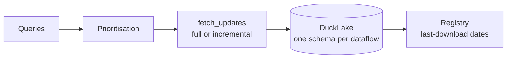
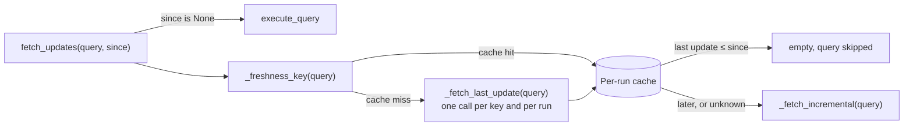

# Incremental downloads

[`download_updates`][statflows.core.download.download_updates] is a one-call
wrapper around [`SDMXDownloader`][statflows.core.download.SDMXDownloader]. For a
list of queries it:

1. **prioritises** the queries — series absent from the registry first;
2. runs a **full download** for the series not yet stored, and an **incremental
   download** (only what was published since the recorded date) for the others,
   through `client.fetch_updates`;
3. **writes** each result into a DuckLake catalog, one schema per *dataflow*
   (creation on the first write, upsert by primary key afterwards);
4. records the date of the last download of every query in a **JSON registry**,
   stored locally or on S3, together with the date and DuckLake snapshot of the
   last download that actually **changed** its data.



!!! note "Registry invariant"
    A registry entry **never** advances before the data of its query has been
    written. A failed write leaves the entry untouched: the query is simply
    downloaded again on the next run.

## The run report

`download_updates` returns a [`DownloadReport`][statflows.core.reports.DownloadReport]
(queries processed, rows written, errors, HTTP and rate-limit statistics,
`stopped_early`), made of one [`QueryReport`][statflows.core.reports.QueryReport]
per query. `report.to_metrics()` flattens it for an experiment tracker; the
`on_query_complete` callback streams each `QueryReport` as soon as it is ready.

## Last-update check and per-run cache

OECD filters incremental downloads on the server (`updated_after`). Eurostat
and UN Comtrade cannot: before pulling a query, their client asks *when the
data was last updated* and skips the query when nothing changed since the
recorded date. That question is shared by many queries — every product batch
of a Eurostat dataflow, every product batch of a Comtrade period — so the
answer is cached for the run by
[`FreshnessCheckMixin`][statflows.core.client.FreshnessCheckMixin], which
provides the whole `fetch_updates` logic:



| Provider | Freshness key | Last-update source | Incremental fetch |
|----------|---------------|--------------------|-------------------|
| Eurostat | `(dataflow, version)` | `UPDATE_DATA` annotation of the dataflow artefact | last `n_observations` observations |
| UN Comtrade | period, frequency, type, classification, reporters | `lastReleased` of the tariffline availability | full re-pull of the slice |

A Eurostat dataflow queried by 17,752 queries therefore costs **one** request of
a few kilobytes per run, instead of 17,752 requests.

**Rules.**

- The cache lives in the client instance, is never persisted, and is emptied at
  the start of every `SDMXDownloader.run()`.
- A last-update date strictly later than `since` always triggers the fetch; an
  unknown date (failed lookup, or none published) refreshes as a precaution.
- A failed lookup is remembered for `FRESHNESS_FAILURE_TTL` seconds (5 minutes by
  default) before one new attempt: a provider down does not cost one doomed
  lookup per query, and a short outage does not force refreshing the whole run.
  Comtrade remembers the failure for the whole run (daily quota).
- **Update published during the run.** A query skipped on a cached answer has
  its registry date set to the instant that answer was requested, not to the
  start of the query: an update published in between is detected at the next
  run.
- The orchestrator calls the client from a single thread; a client must not be
  shared across threads.

**Observability.** Each `QueryReport.freshness` counts the lookups sent
(`n_checks`), the answers served by the cache (`n_cache_hits`) and the
unresolved lookups (`n_unresolved`); `DownloadReport.to_metrics()` sums them as
`n_freshness_checks`, `n_freshness_cache_hits` and `n_freshness_unresolved`,
next to `n_http_requests`.

## Time limit and graceful shutdown

`max_runtime` (23 hours by default) stops the loop between two queries once the
deadline has elapsed. On `SIGTERM` — e.g. a Kubernetes pod being stopped — the
fetch in progress is aborted, pending writes and the registry are flushed, and
`run()` returns its report with `stopped_early=True`.

## Reading the registry

Downstream steps read the registry with
[`iter_registry_entries`][statflows.core.registry.iter_registry_entries], which
works whether the registry is a single file or sharded, local or on S3, and
yields frozen [`RegistryEntry`][statflows.core.registry.RegistryEntry] objects.

Each entry carries two dates, with different purposes:

| Field | Moves when | Use it to |
| --- | --- | --- |
| `last_download` | every successful download, even if nothing changed | prioritise the next download run |
| `last_modified` (+ `last_modified_snapshot`) | the download actually inserted or updated rows in DuckLake | decide whether downstream steps must run |

An empty response, or an upsert of values identical to the stored ones, moves
`last_download` only. `last_modified` is `None` for a query whose data was never written.
`DownloadReport.n_modified` (and `QueryReport.data_modified`) give the same
information for the run just finished.

## Conditioning downstream steps

The registry tells *whether* a query changed. To know *what* to recompute,
read DuckLake's change feed with
[`changes_since`][statflows.storage.ducklake.tables.changes_since], from a
**watermark owned by the downstream step** — the snapshot it last processed:

```python
from statflows.storage.ducklake.tables import changes_since

watermark = load_my_watermark()  # None on the first run
changes = changes_since(conn, "db", "namq_10_gdp", watermark)
if changes.modified:
    recompute(start_period=changes.min_time_period)  # earliest period touched
    save_my_watermark(changes.current_snapshot)  # only once the step succeeded
```

Because the watermark belongs to the consumer, a skipped or failed downstream
run loses nothing: the next call covers every snapshot since. A snapshot that
only stamped metadata (an unchanged upsert) counts as no change.

### Touched slices and pinned reads

`min_time_period` is a single value for the whole table. When a step works by
slices (a vintage, a vintage x period context, a reporter…), ask for the
distinct values of the columns defining them with `key_columns`, and pin the
upper bound of the changes to the snapshot the step reads at:

```python
from statflows.storage.ducklake.tables import changes_since, current_snapshot

pinned = current_snapshot(conn, "db")  # read every input AT (VERSION => pinned)
changes = changes_since(
    conn,
    "db",
    "indicators",
    watermark,
    key_columns=["classification", "TIME_PERIOD"],
    until_snapshot=pinned,
)
for classification, period in changes.changed_keys:  # inserted, updated, deleted rows
    recompute(classification, period)
save_my_watermark(changes.current_snapshot)  # == pinned
```

`changed_keys` covers the inserted rows, both images of the updated rows and
the deleted rows. It is `None` when no key column is requested, and an empty
set when nothing changed. On a first run (`watermark=None`) it holds every
distinct tuple of the table: choose coarse columns, not the primary key of a
large table. With `until_snapshot`, a write committed by another process during
the step is left to the next run instead of being half-read.

!!! warning "Snapshot expiration"
    `changes_since` raises `ValueError` when the snapshots following the
    watermark were expired (`ducklake_expire_snapshots`): the changes can no
    longer be known, so recompute everything and restart from
    `changes_since(..., None)`. Keep the snapshot retention longer than the
    interval between two downstream runs.

For large catch-ups, see [Performance and volume](performance.md).
